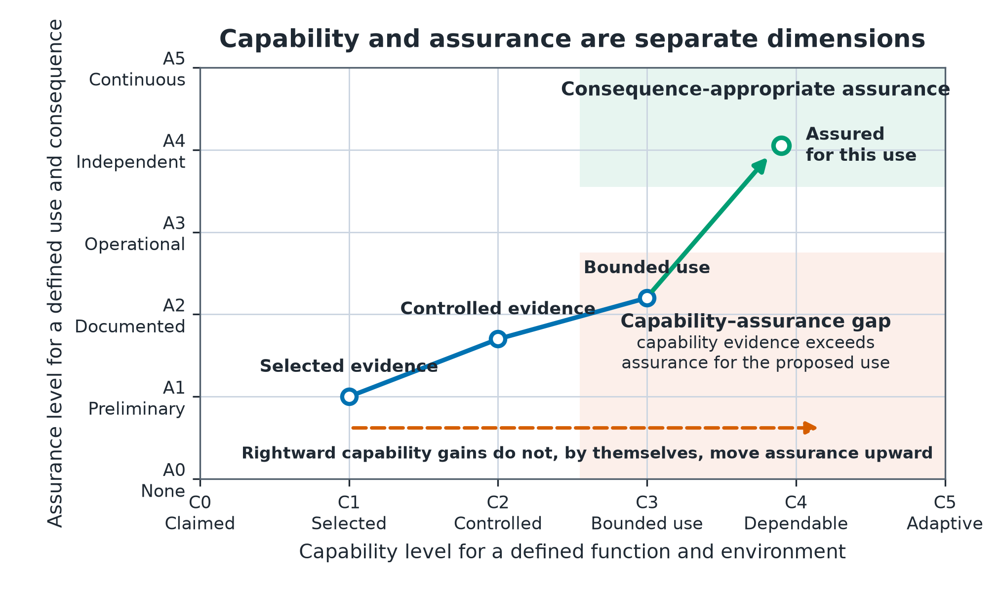
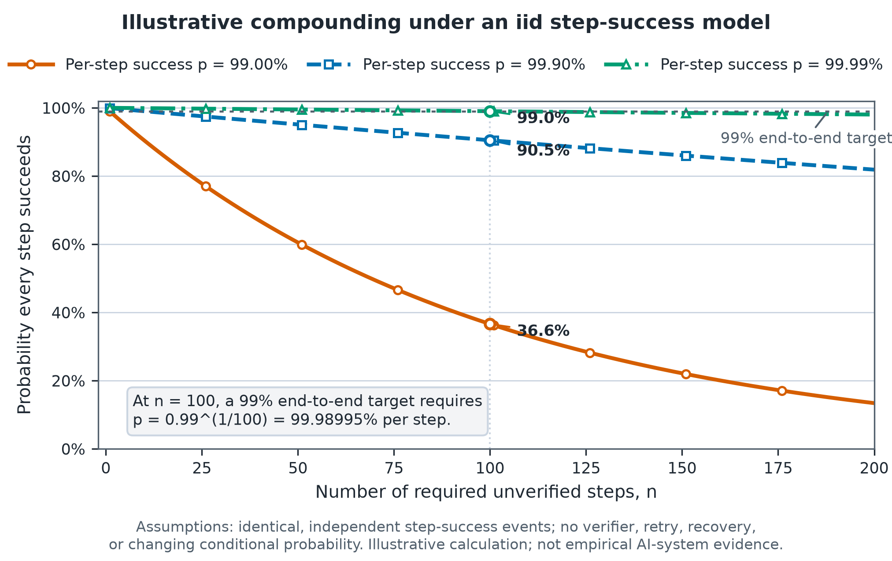
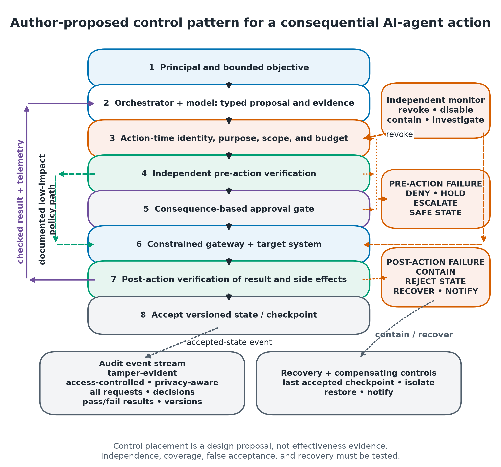

# The Capability–Reliability Gap in Artificial Intelligence

An evidence-graded review, maturity framework, and research agenda covering the period from 2020 through August 28, 2026.

**Author:** Angelis Pseftis  
**Status:** Working paper prepared for independent publication; not externally peer reviewed  
**Evidence cutoff:** August 28, 2026

## Paper

[Read the working paper](paper/capability-reliability-gap-ai.pdf).

The paper examines the difference between demonstrated AI capability and the evidence needed to justify dependable operation. It separates capability from assurance, grades both evidence strength and operational transfer, and proposes a research agenda for high-reliability long-horizon execution, runtime verification, dynamic and field evaluation, agent identity and authorization, containment and recovery, calibrated uncertainty, and incident learning.

The capability–assurance framework, domain assignments, priority tiers, scenarios, and control architecture are author-developed analytical tools. They are not consensus standards or validated measurement instruments. Figure 2 is an illustrative calculation under an identical, independent step-success model; it is not empirical AI-system evidence.

## Repository contents

- `paper/` — public working-paper PDF
- `figures/` — publication figures in PNG format
- `data/` — figure source data and the analytical tables used in the paper
- `src/` — figure-generation source code
- `requirements.txt` — pinned figure-generation dependencies
- `CITATION.cff` — citation metadata

## Reproduce the figures

Python 3.12 was used for the retained figure exports.

```bash
python3 -m venv .venv
source .venv/bin/activate
python -m pip install -r requirements.txt
python src/generate_figures.py --figures figures --data data
```

The command regenerates Figures 1–3 and rewrites `data/reliability_compounding_long.csv`. The calculation assumptions are recorded in the CSV and in the Figure 2 caption.

## Figures

### Capability and assurance are separate dimensions



### Illustrative reliability compounding



### Consequence-aware agent assurance architecture



## Citation

Use the repository's `CITATION.cff` metadata. No DOI, journal acceptance, institutional affiliation, or external peer-review status is claimed.

## Reuse

No reuse license has been selected. The absence of a license does not grant permission beyond applicable law.
